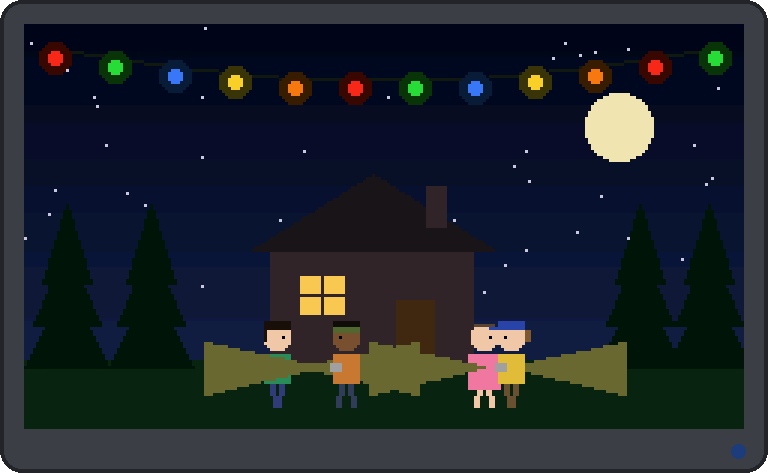
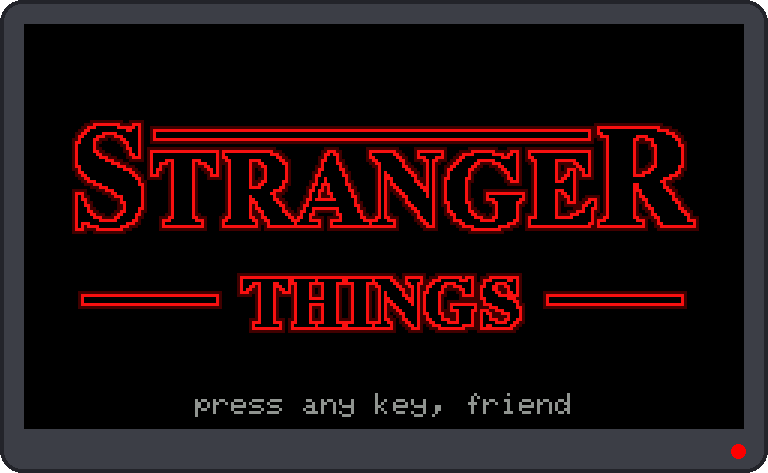
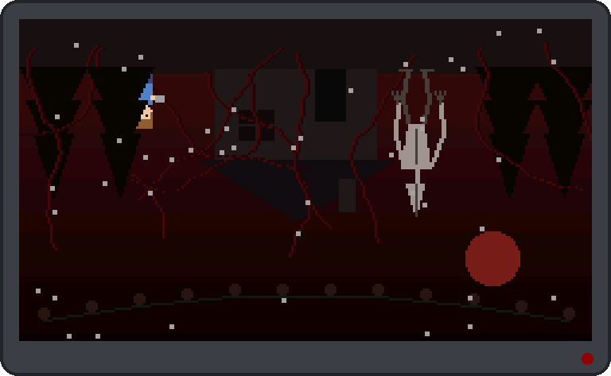
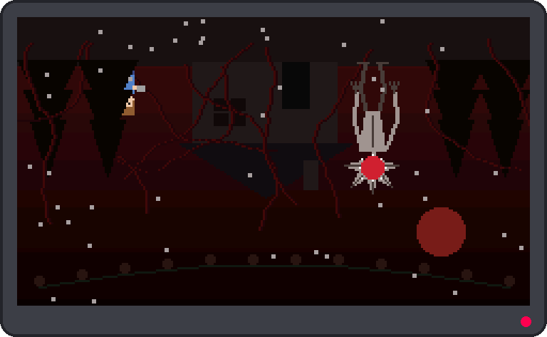

# ST Cardputer: The Upside Down Switch 🔦

A Stranger Things fan project for the [M5Stack Cardputer](https://docs.m5stack.com/en/core/Cardputer), a pocket-sized
ESP32-S3 computer with a 240x135 colour screen, a keyboard, a speaker and an RGB LED.

I built this with my niece (grade 9) on **Take Your Kid to School Day**. She didn't think coding was her thing, and she
had mostly heard bad things about AI. So she came up with the ideas (the Demogorgon outside the house,
Will hiding, the friends searching for him), and each one was running on a real device a few minutes later.
She liked it, and said it was fun. 🙂



## What it does

| | |
|---|---|
|  | **Title card.** The logo is drawn in code with outlined letters and fades in like an old neon sign, with a low drone. Press any key. |
|  | **Hawkins at night.** Twinkling Christmas lights and crickets. Eleven, Mike, Dustin and Lucas walk the street with flashlights, calling "Will?" |
|  | **Press a key: the Upside Down.** The world rips, flips upside down and turns red: vines, floating ash, red lightning, one dead Christmas light flickering. Will hides behind a tree with his flashlight. |
|  | **The Demogorgon.** Every few seconds its head opens, it growls and the LED goes red. IF its head is open, THEN Will hides, ELSE he peeks out. |

Every pixel and every sound is made from code: there are no image or audio files.

## Tweak it

The top of [`firmware/upside_down/upside_down.ino`](firmware/upside_down/upside_down.ino) has a **TWEAK ME!** block.
Change a number, flash again, see what happens:

```cpp
#define ASH_COUNT        45    // how many ash flakes float in the Upside Down
#define LIGHTNING_CHANCE 120   // 1 in this many frames gets a red lightning flash (smaller = more)
#define DEMO_X           166   // where the Demogorgon stands (0 = far left, 239 = far right)
#define WILL_PEEK        12    // how far Will leans out from behind his tree (0 = never)
#define FRIEND_SPEED     1.0   // how fast the friends walk while they search for Will
```

Try `LIGHTNING_CHANCE 5` for a storm.

## Build and flash

- arduino-cli with the **esp32 core 2.0.17** and **TFT_eSPI 2.5.43** (screen settings come from
  `firmware/screens/cardputer.h`, so the library's own `User_Setup.h` is left alone)
- Optional: `cp firmware/upside_down/config.h.example firmware/upside_down/config.h` and put your name in it, so the
  title says "press any key, *you*"

```
make flash SKETCH=firmware/upside_down     # the Upside Down Switch
make flash SKETCH=firmware/hello           # a simple "Hello" test
```

## Emulator

`make sim` runs the real sketch on a laptop (fake clock, scripted key presses, the library's own fonts) and saves the
screenshots above to `docs/screenshots/`. Needs g++ and Python PIL.

## Credits

Ideas and testing by my niece; built and mentored by DFIR-life.

Fan project, not affiliated with Netflix. Stranger Things is a trademark of Netflix. The Cardputer is made by M5Stack.
